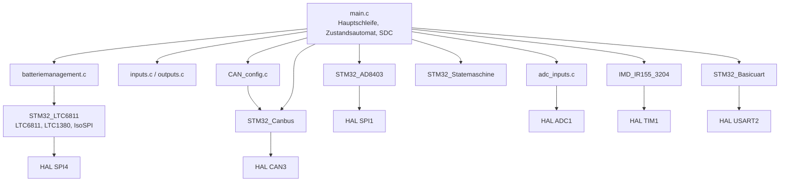
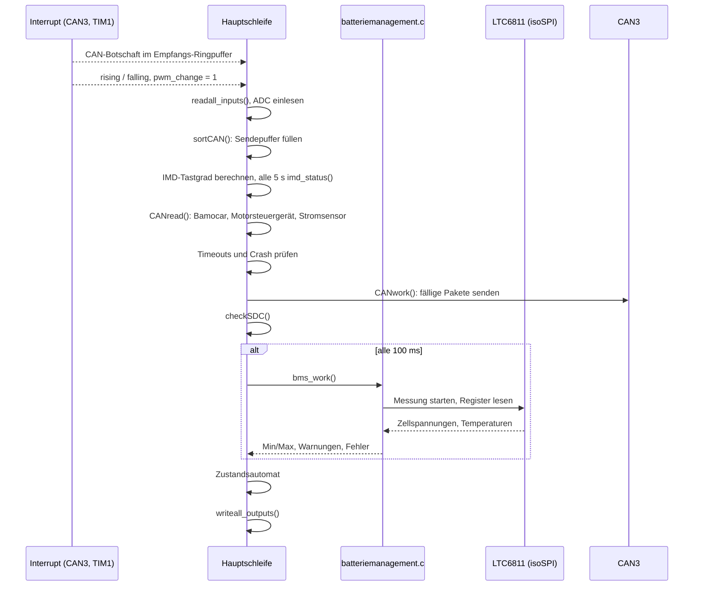
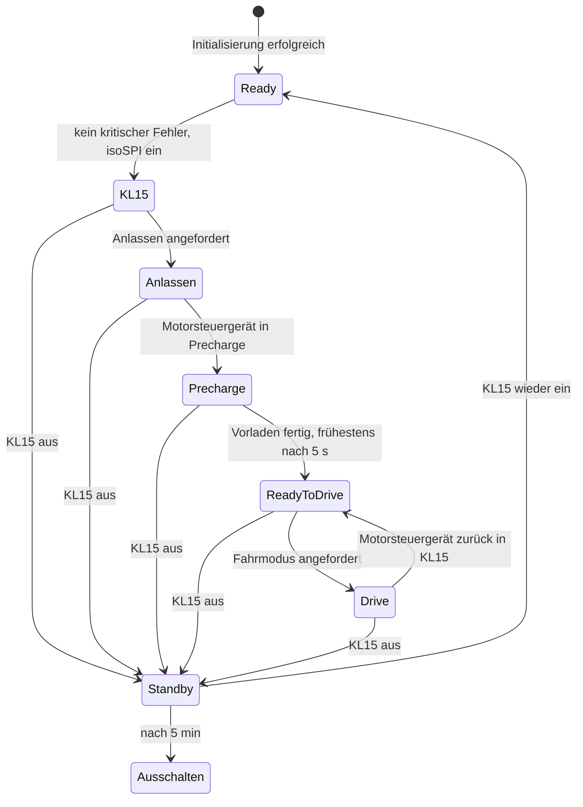

# Architektur EAuto BMS

Die Firmware arbeitet in einer einzigen Hauptschleife ohne RTOS. Jeder Durchlauf liest
alle Ein- und Analogeingänge, verarbeitet empfangene CAN-Botschaften, führt den
Zustandsautomaten weiter und schreibt alle Ausgänge. Interrupts gibt es nur für CAN und
für die PWM-Auswertung des Isolationswächters.

## Komponenten

| Modul | Datei(en) | Aufgabe |
|---|---|---|
| Hauptprogramm | `Core/Src/main.c` | Initialisierung, Hauptschleife, Zustandsautomat, `checkSDC()`, `sortCAN()` |
| Projektkonfiguration | `Application/Inc/BatteriemanagementSystem.h` | Version, Aufbau (Tisch/Fahrzeug), vorhandene Steuergeräte, CAN-IDs, Zeitkonstanten |
| Batteriemanagement | `Application/Src/batteriemanagement.c` | Selbsttest, Zellspannungen und -temperaturen einlesen, Min/Max, Modul- und Gesamtspannung |
| Ein-/Ausgänge | `Application/Src/inputs.c`, `outputs.c` | Digitale Eingänge in Bitfelder einlesen, Bitfelder auf Ausgänge schreiben |
| Analogeingänge | `Application/Src/adc_inputs.c` | Einzelmessung je Kanal mit ADC1 |
| CAN-Konfiguration | `Application/Src/CAN_config.c` | Sendepakete mit ID, Länge und Intervall in die Paketliste eintragen |
| Stromsensor | `Application/Src/stromsensor.c` | Botschaften des HV-Stromsensors auswerten |
| Fehler | `Application/Src/error.c` | Fehlerausgabe über UART und ITM |
| Hilfsfunktionen | `Application/Src/millis.c`, `my_math.c`, `temperatur.c`, `app_info.c` | Zeitbasis, gleitender Mittelwert, Temperaturumrechnung, Versionsausgabe |
| Bibliotheken | `Lib/*` | Submodule, siehe [README](README.md#abhängigkeiten) |

## Datenfluss

Ablauf eines Durchlaufs der Hauptschleife. CAN-Empfang und IMD-Messung laufen im
Interrupt und legen ihre Daten nur ab, ausgewertet wird in der Hauptschleife.

Zustände des BMS (`Main_Statemaschine.State`):

Unabhängig vom Zustand setzt ein ausgelöster Crash-Eingang den Status `CriticalError`,
nimmt Freigabe, AMS OK und IMD OK zurück und setzt den Zustand auf `Ready`. Dauert das
Vorladen länger als 10 s, wird das Precharge-Relais abgeschaltet und ebenfalls
`CriticalError` gesetzt.

## Speicher und Ressourcen

| Ressource | Verwendung |
|---|---|
| Flash / RAM | STM32F767ZI, 2 MB Flash, 512 KB RAM; Linker-Skripte `STM32F767ZITX_FLASH.ld` und `STM32F767ZITX_RAM.ld` |
| CAN3 | Antriebs-CAN, 500 kbit/s, Empfang über FIFO0-Interrupt, Sende- und Empfangsring mit je 16 Einträgen |
| CAN1 | initialisiert, derzeit ungenutzt |
| SPI4 | isoSPI zu den LTC6811 |
| SPI1 | AD8403 |
| ADC1 | Einzelmessung im Polling, 15 Abtastzyklen |
| TIM1 | Input Capture Kanal 1 (steigende Flanke, PE9) und Kanal 2 (fallende Flanke, intern) für die IMD-PWM, IRQ-Priorität 0 |
| TIM4 | PWM Kanal 1–3 an PD12–PD14 für die HV-Relais HV−, HV+ und HV/ |
| USART2 | Debug-Ausgabe, 115200 Baud |
| CAN-Paketliste | 64 Sendepakete, davon die Zellen- und Temperaturpakete für Modul 2–8 derzeit deaktiviert (`sendpossible = 0`) |

## Nebenläufigkeit

| Kontext | Was läuft dort | Gemeinsame Daten |
|---|---|---|
| CAN3-Interrupt | Botschaft aus FIFO0 in den Empfangsring, nächste Botschaft aus dem Sendering senden | Ringpuffer der Bibliothek STM32_Canbus; der Zugriff aus der Hauptschleife sperrt kurz den jeweiligen CAN-Interrupt |
| TIM1-Interrupt | `HAL_TIM_IC_CaptureCallback()`: gleitender Mittelwert der Flanken | `rising`, `falling`, `pwm_change` als `volatile`; ausgewertet und zurückgesetzt in der Hauptschleife |
| SysTick | Zeitbasis für `millis()` | – |
| Hauptschleife | alles andere | – |

## Erweiterung

- **Neue Sendebotschaft:** ID in `BatteriemanagementSystem.h` anlegen, Paket in
  `CAN_config.c` eintragen, `ANZAHL_OUTPUT_PAKETE` in `main.h` erhöhen und die Daten in
  `sortCAN()` oder im zuständigen Modul in `CAN_Output_PaketListe[n].msg.buf` schreiben.
  [docs/CAN.md](docs/CAN.md) im selben Commit anpassen.
- **Neue Empfangsbotschaft:** ID in `BatteriemanagementSystem.h` anlegen und einen `case`
  im `switch (RxMessage.id)` der Hauptschleife ergänzen, bei Bedarf mit Timeout wie beim
  Stromsensor.
- **Neues Steuergerät:** eigenes `*_AVAILABLE`-Define anlegen und Auswertung sowie
  Timeout damit einklammern.
- **Neuer Ein- oder Ausgang:** Pin in CubeMX anlegen, Bit in `inputs.h` bzw. `outputs.h`
  ergänzen, in `readall_inputs()` bzw. `writeall_outputs()` verarbeiten und in
  [docs/INPUTS.md](docs/INPUTS.md) bzw. [docs/OUTPUTS.md](docs/OUTPUTS.md) eintragen.
